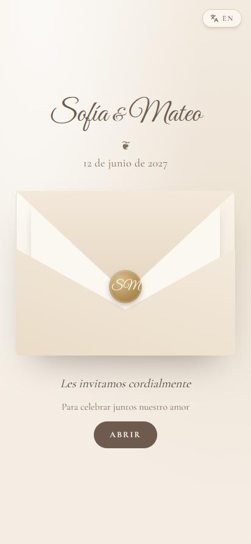
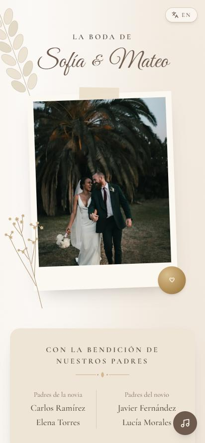
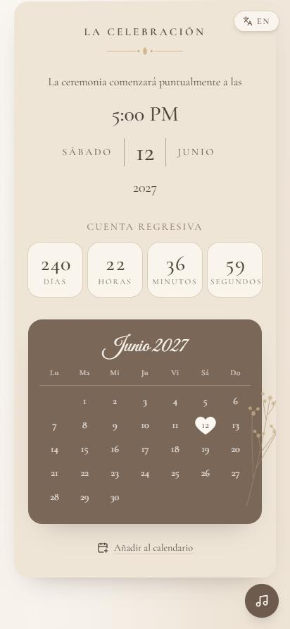
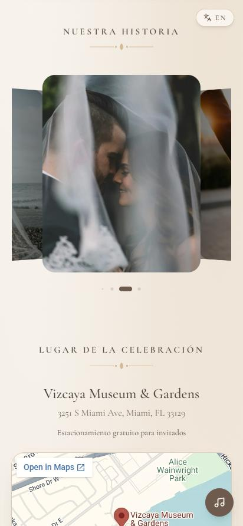
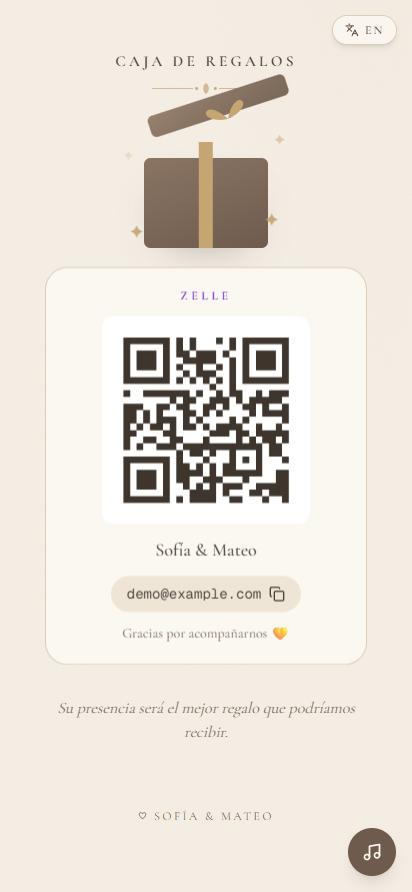
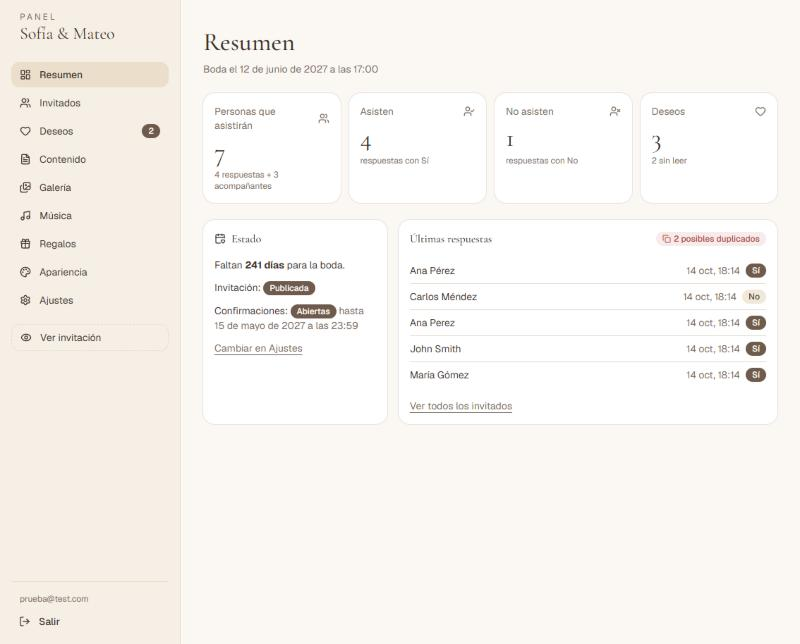
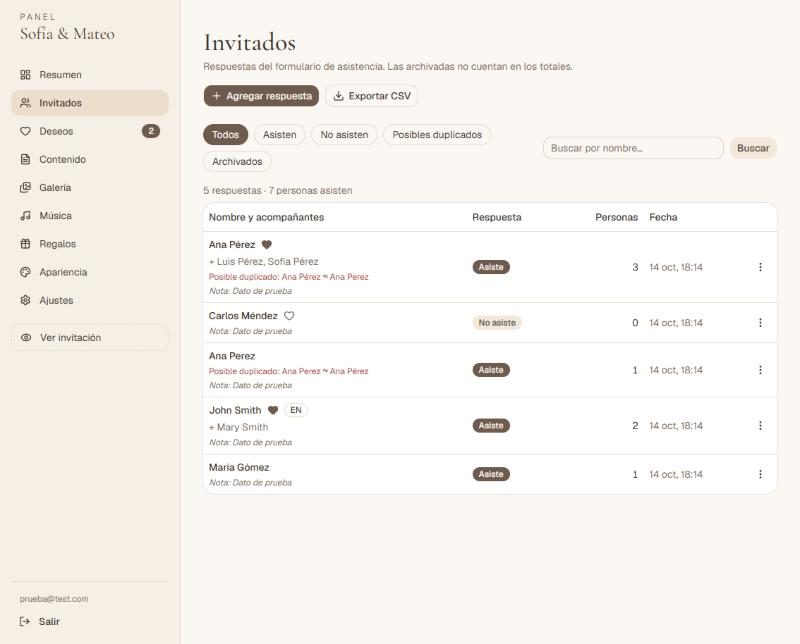
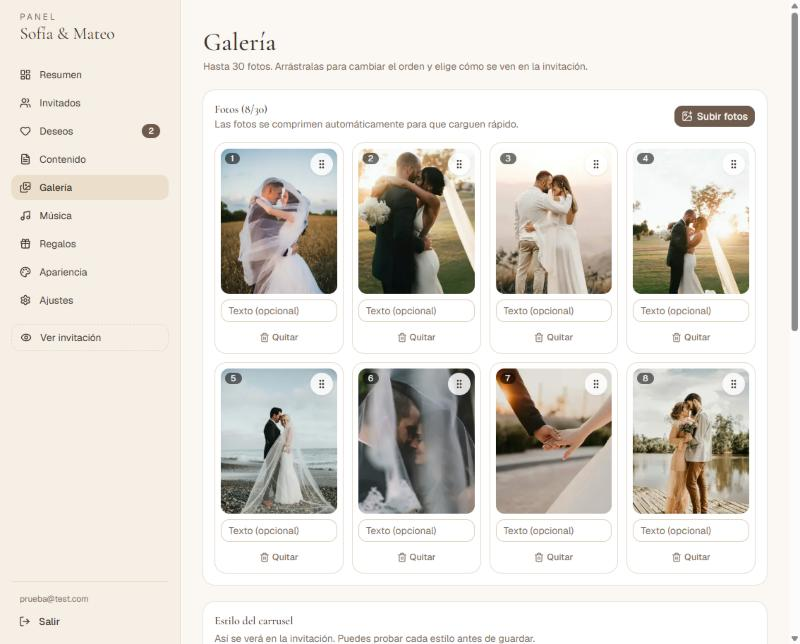
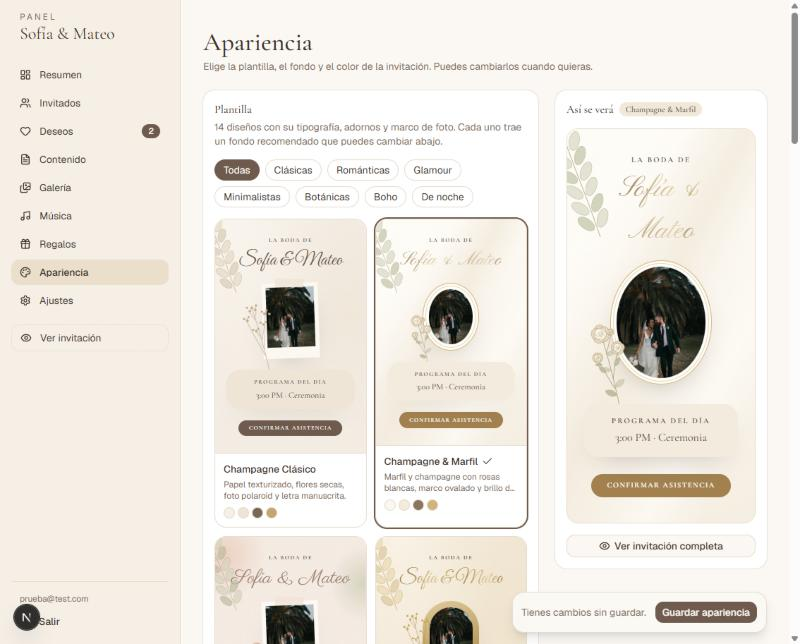
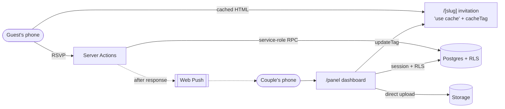

<div align="center">

# Lazo de Oro

**Free wedding websites: couples design their invitation without an account, publish it and follow every reply from their dashboard.**

Guests get a fast, bilingual, mobile-first invitation with RSVP, music, a 3D photo gallery and a gift box.
The couple manages every detail from a dashboard and gets a push notification on their phone for every answer.

[](https://github.com/Daniiel18/plataforma-bodas/actions/workflows/ci.yml)


**[Website](https://lazodeoro.vercel.app)** · **[Live demo](https://lazodeoro.vercel.app/demo)** · **[Create one](https://lazodeoro.vercel.app/crear)** · **[Try it](#-try-it)** · **[Architecture](docs/architecture.md)** · **[Deployment](docs/deployment.md)**

</div>

<p align="center">
  
  
  
  
  
</p>

## ✨ Features

### For couples discovering it

- **Landing page** in Spanish or English (picked from the phone), with a real invitation running inside a phone, how it works and an FAQ.
- **One indexable demo per template** (`/demo/<template>`) with a *Create yours with this template* button.
- **Builder without an account** (`/crear`): a 14-step guide — names, date, template, envelope and cover, parents, venue map, schedule, dress code, photos, music, gifts, replies — with a live preview of every step. Everything is saved on the device (photos and music in IndexedDB) until the couple signs in, which publishes it right away and opens the share dialog — or saves it to their account unpublished, to go on from any device.

- **Sign in with Google or an emailed code** (`/entrar`): no password to remember, Google's consent screen shows *Lazo de Oro*, and the email arrives in the language of the page.

### For guests

- **Animated envelope** that opens the invitation and starts the background music (the tap browsers require for audio).
- **Live countdown** (days, hours, minutes, seconds) computed in the wedding's time zone, plus a month calendar.
- **One-tap add to calendar** that picks the right app for the guest's device — Apple Calendar on iPhone, Google Calendar on Android, an `.ics` file on computers — with a reminder the day before.
- **3D photo gallery** in five styles — coverflow, cube, stacked cards, flip and a custom 3D ring — with swipe and full-screen viewer.
- **Venue map** pointing at the exact spot the couple pinned, with a single *Get directions* button: Android shows the system's app chooser (Google Maps, Waze…), iPhone gets a native-style sheet with Apple Maps, Google Maps and Waze.
- **Gift box** that opens to reveal every way the couple accepts gifts: Zelle (QR code, *Send with Zelle* button with the couple as recipient, *Save QR* straight to the photo library), PayPal.me, bank transfer details with copy buttons, and gift-registry links.
- **Two-step reply**: attendance and named companions, then an optional private wish — saved together, so the couple gets a single notification. A personal link lets guests change *Yes ↔ No* from any device until the deadline.
- **Spanish and English**, picked from the phone's language with a flicker-free toggle that never interrupts the music.

### For the couple

- **Overview**: attendees, companions, declines, unread wishes, days to go and possible duplicates.
- **Guest list** with filters, accent-insensitive search, duplicate detection (fuzzy matching across guests *and* companions), notes, archiving, manual entries and **CSV export**.
- **Content editor** with a **live preview of each visual section in the chosen template** that follows the typing, plus show/hide and reordering. Text written in Spanish is **auto-translated on save** and can be corrected by hand.
- **Venue picker**: search the address on a map and drag the pin to the exact entrance — guests' map, directions and calendar event use that point.
- **Gallery manager**: up to 30 photos, compressed in the browser, drag-and-drop ordering and a live preview of every 3D style.
- **Template studio**: 14 templates in seven collections (classic, romantic, glamour, minimal, botanical, boho and evening), 14 page backgrounds — from silk and marble to damask, lace and art déco, or the couple's own photo — and curated accent colors, all mixable with a live preview.
- **Music and gifts**: pick a song from the built-in public domain library or upload their own, and turn on the gift methods they want — Zelle (with its QR), PayPal, bank transfer or registry links.
- **Live dashboard**: answers and wishes appear instantly as in-app notifications and every page updates itself, no reload needed (Supabase Realtime).
- **Push notifications** to the couple's phones (installable as an app): one per answer, with the wish included, and one per change.
- **Share on publish**: the moment the invitation goes live, a dialog offers the link and a ready-made invitation message (optionally bilingual) for Messages/iMessage, WhatsApp, Messenger, Telegram, Facebook, email or the phone's share sheet.
- **Live preview** of the invitation before publishing.

<p align="center">
  
  
  
  
</p>

## 👀 Try it

- **Guests' side:** open the **[live demo](https://lazodeoro.vercel.app/demo)** on your phone — the envelope, music, gallery, map and the reply form all work.
- **Couple's side:** **[create an invitation](https://lazodeoro.vercel.app/crear)** without an account and preview it; signing in publishes it and opens its dashboard.

## 🧱 Tech stack

| Layer | Technology |
| --- | --- |
| Framework | [Next.js 16](https://nextjs.org) App Router with Cache Components, ISR and Server Actions |
| UI | React 19, TypeScript (strict), Tailwind CSS 4, [shadcn/ui](https://ui.shadcn.com) on Radix |
| Data | [Supabase](https://supabase.com): Postgres with Row Level Security, Auth and Storage |
| Guest experience | Swiper (3D effects), custom CSS 3D ring, `next/image`, HTML5 audio |
| Validation | Zod on every Server Action and form |
| Notifications | Web Push (VAPID) with an installable PWA dashboard |
| Maps | Leaflet + OpenStreetMap with Nominatim search (venue picker), Google Maps embed for guests |
| Translation | MyMemory API, on save only, with manual overrides |
| Quality | ESLint, Prettier, Vitest, GitHub Actions, Dependabot |
| Hosting | Vercel (Hobby) + Supabase (Free) — **$0 per month** |

## 🏗️ Architecture



- The invitation is **cached and served from the CDN**; any change in the dashboard invalidates it instantly with `updateTag`.
- The dashboard is **always rendered per request**: data streams behind `<Suspense>` and every Server Action re-authorizes itself.
- Guests never write to tables: RSVPs go through **`SECURITY DEFINER` functions** only the server can execute, with deadlines, limits and rate limiting enforced in the database.

Read more in [docs/architecture.md](docs/architecture.md) and [docs/database.md](docs/database.md).

## 🚀 Getting started

**Requirements:** Node.js 22+ and a free [Supabase](https://supabase.com) project.

```bash
git clone https://github.com/Daniiel18/plataforma-bodas.git
cd plataforma-bodas
npm install
cp .env.example .env.local      # fill in your Supabase keys (see docs/deployment.md)
npm run db:migrate              # create tables, policies and functions
npm run demo:seed               # optional: fictional wedding at /demo
npm run dev
```

Open [localhost:3000/demo](http://localhost:3000/demo), or design an invitation at [localhost:3000/crear](http://localhost:3000/crear) and publish it by signing in. To create a wedding by hand for an existing account:

```bash
npm run wedding:create -- ana-y-luis "Ana López" "Luis Pérez"
npm run admin:link -- couple@email.com ana-y-luis
```

### Scripts

| Command | Description |
| --- | --- |
| `npm run dev` | Development server |
| `npm run build` / `npm start` | Production build / server |
| `npm run check` | Lint, type check, unit tests and formatting — the same gate as CI |
| `npm test` | Unit tests (Vitest) |
| `npm run db:migrate` | Apply pending SQL migrations |
| `npm run db:backup` | Save every table and uploaded file under `backups/` |
| `npm run wedding:create` | Create a wedding with all its sections |
| `npm run admin:link` | Give an account access to a wedding (`--viewer` for read-only) |
| `npm run demo:seed` / `demo:data` | Create the demo wedding / sample guests |

## 🔐 Security

Row Level Security on every table, server-only RSVP functions, hashed guest tokens, rate limiting, a read-only `viewer` role and secrets kept on the server. Details and how to report a vulnerability: [SECURITY.md](SECURITY.md).

## 📚 Documentation

| Document | Contents |
| --- | --- |
| [Architecture](docs/architecture.md) | Rendering and caching, bilingual pages, templates, RSVP flow, media, notifications, maps |
| [Database](docs/database.md) | Schema, Row Level Security, server-only functions, realtime, integrity rules |
| [Deployment](docs/deployment.md) | Supabase and Vercel setup, environment variables, recommended settings |
| [Operations](docs/operations.md) | Onboarding a couple, backups, key rotation, monitoring, releases, incident checklist |
| [Roadmap](docs/roadmap.md) | What comes next on the way to a multi-couple product |

## 🤝 Contributing

Issues and pull requests are welcome — please read [CONTRIBUTING.md](CONTRIBUTING.md) and the [Code of Conduct](CODE_OF_CONDUCT.md) first. Changes are listed in the [Changelog](CHANGELOG.md).

## 🙏 Credits

- Demo photos from [Unsplash](https://unsplash.com/s/photos/wedding-couple), free to use under the [Unsplash License](https://unsplash.com/license).
- Demo music: *Canon in D Major* by Kevin MacLeod ([incompetech.com](https://incompetech.com)), licensed under [Creative Commons: By Attribution 4.0](https://creativecommons.org/licenses/by/4.0/).
- Botanical illustrations are original SVG artwork made for this project.

## 📄 License

Copyright © 2026 Daniel Espinal ([@Daniiel18](https://github.com/Daniiel18)). All rights reserved. The source code is available for viewing only — see [LICENSE](LICENSE).
