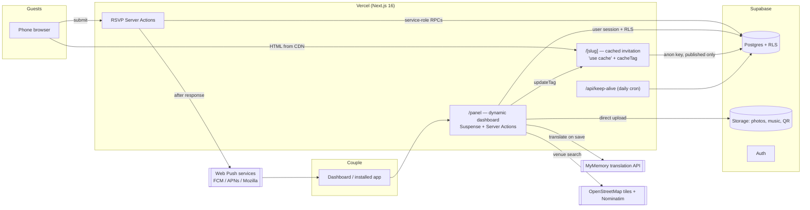
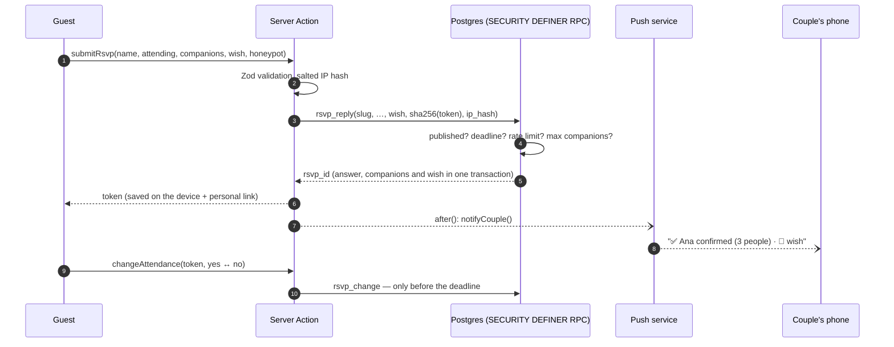

# Architecture

The platform (**Lazo de Oro**) is a single Next.js 16 application backed by Supabase. It serves three audiences from the same codebase:

- **Couples discovering it** land on the platform site (`/`), browse one demo per template (`/demo/<template>`) and design their invitation in the builder (`/crear`) without an account.
- **Guests** open a public, cached, mobile-first invitation (`/<slug>`). It must load instantly on mobile data and work without an account.
- **The couple** sign in at `/entrar` (Google or a code sent by email) and use a private dashboard (`/panel`) that is always rendered per request, behind authentication and Row Level Security. `/admin` redirects there; it is reserved for the platform's own back office.



## Rendering and caching

Next.js 16 runs with **Cache Components**. Partial Prefetching is deliberately **off**: without it, the first request for an invitation that was not prerendered waits for its data instead of receiving a generic App Shell, which lets unknown or unpublished slugs answer with a real `404` status.

| Route | Strategy | Why |
| --- | --- | --- |
| `/[slug]` | `getPublicInvitation()` is a `"use cache"` function with `cacheLife("max")` and `cacheTag("invitation:<slug>")`. `generateStaticParams` prerenders every published invitation at build time; any other slug is rendered on its first visit and stored (ISR). The page awaits `params` and the data before streaming, so a missing invitation returns `404`. | Every guest gets a static page from the CDN. |
| `/panel/*` | Each page renders a static header and streams its data behind `<Suspense>`. `getAdminContext()` calls `connection()` and is memoized per request with React `cache()`. | Session-dependent data can never be prerendered or shared. |
| Server Actions | Every mutation re-checks the session, the wedding membership and the role, then calls `updateTag("invitation:<slug>")`. | The couple sees their change on the public invitation immediately (read-your-own-writes). |

## Bilingual invitation without flicker

Guest-facing text is rendered **in both languages** (`<T es="…" en="…" />` emits two spans). A tiny inline script, placed as the first child of the invitation, picks the language before the first paint — the saved preference, otherwise Spanish for Spanish-language phones and English for everything else — and sets `data-lang` on the container. CSS hides the other language.

This keeps the page fully cacheable (one HTML for everyone), switching language is instant, and the background music never stops.

Content the couple writes in Spanish is translated **once, on save** (`syncTranslations`). Each translation stores the Spanish source it came from, so:

- unchanged texts are never re-translated, and manual corrections are preserved;
- editing the Spanish text automatically invalidates the old translation;
- if the translation service is unavailable, the Spanish text is shown and the dashboard flags it as pending.

## Template engine

Templates are **data, not stylesheets**. Each entry in [`src/lib/templates.ts`](../src/lib/templates.ts) declares a palette, a script and a heading font, an ornament set, a photo frame, a card style, a button shape and a recommended background. The invitation turns that into CSS custom properties (`--inv-*`) and `data-*` attributes on its root, and [`invitation.css`](../src/components/invitation/invitation.css) styles every variant once:

| Attribute | Variants |
| --- | --- |
| `data-card` | `soft`, `outline`, `gold`, `veil` |
| `data-frame` | `polaroid`, `arch`, `oval`, `circle`, `deco`, `plain` |
| `data-button` · `data-names` | `pill` / `square` · plain or gold-foil names |
| `data-bg` | 14 backgrounds (see [`src/lib/backgrounds.ts`](../src/lib/backgrounds.ts)) |
| `data-tone` | `dark` switches form controls, errors and the gift box to light-on-dark |

Backgrounds are independent of templates: they are painted on a fixed layer (`.inv-backdrop`) from the template's own colors, with SVG patterns applied as CSS masks, so any template can be combined with any background. The envelope, wax seal and gift box derive their colors from the palette with `color-mix()`, and the botanical ornaments are original SVGs that read `--inv-orn-*` variables.

Adding a template is one object in the catalog; adding a background is one entry plus one CSS rule. Fonts are loaded with `next/font` and only downloaded when a template uses them.

## RSVP flow



The form has two steps — attendance and companions, then the optional wish — and sends everything at once, so the couple receives one notification per guest.

Guests have no accounts. A random 192-bit token identifies their answer; only its SHA-256 hash is stored. The token lives in `localStorage` and in a personal link (`/<slug>?respuesta=<token>`) so the answer can be changed from another device.

## Media pipeline

1. The dashboard compresses photos **in the browser** (canvas → WebP, or JPEG on Safari; max 2000 px) and keeps QR codes as lossless PNG.
2. Files go straight to Supabase Storage under `<wedding_id>/<kind>/<uuid>.<ext>` — never through the server.
3. A Server Action validates the path, type and size and registers the file; a database trigger enforces the limits (30 photos, one cover, one song, one QR).
4. Guests receive images through `next/image`, so Vercel's CDN serves optimized versions and Supabase egress stays low. Music is only downloaded after the guest opens the envelope.

### Music

The music section stores `track`, a song of the library (`src/lib/music-library.ts`, public domain recordings served from `/public/music`), or null to play the couple's own upload; uploading a song resets it to null. Library songs live on Vercel's CDN, not in Storage.

### Photo framing

Each photo keeps how the couple framed it in `media.crop` (`src/lib/photo-crop.ts`): the point of the photo shown at the frame's center and a zoom where 1 fills the frame. Below 1 the whole photo can show, over a blurred copy of itself; the zoom is relative, so one framing serves every frame shape (4:5 polaroid, square or ring carousel cards, any screen). `FramedPhoto` places cover and gallery photos from that geometry; the page background does it in CSS (`.inv-backdrop::before` with container units), because its frame is the guest's screen. The *Ajustar* dialog (`src/components/editor/photo-crop-dialog.tsx`) is shared by the dashboard and the builder, which keeps the framing in the draft and sends it when publishing.

## Notifications and live dashboard

The dashboard is an installable PWA ("Mi boda"). Enabling notifications registers `public/sw.js`, subscribes with VAPID and stores the subscription in `push_subscriptions`. For every answer (with its wish) and every change the server sends an encrypted Web Push message; expired subscriptions (HTTP 404/410) are removed automatically. On iPhone, Web Push requires adding the dashboard to the home screen (iOS 16.4+).

While the dashboard is open it also listens to `rsvps` and `wishes` through **Supabase Realtime** (`postgres_changes`, filtered by wedding). The channel joins with the couple's session token, so Row Level Security decides which changes reach it. New answers show an in-app notification — grouped with their wish — and the current page refreshes itself; coming back from the background triggers a refresh too.

## Sharing

Publishing the invitation opens a share dialog: the link, a ready-made invitation message in Spanish (English optional) built by [`src/lib/share.ts`](../src/lib/share.ts), and one-tap links for Messages/iMessage (`sms:`), WhatsApp, Messenger, Telegram, Facebook, email and the native share sheet. Link previews use the couple's cover photo.

## Venue location

The location section stores the written venue and address plus an optional exact point (`lat`, `lng`).

- **Picking the point.** The content editor shows a Leaflet map with OpenStreetMap tiles (free, no key). *Search the address* geocodes it with Nominatim; the couple then drags the pin — or taps the map — to the exact entrance, and can adopt the reverse-geocoded address of that point. Both lookups run in Server Actions (`geocode.ts`) that require a dashboard session, send an identifying `User-Agent` as Nominatim's usage policy asks, and only happen on demand.
- **Using the point.** When it is set, the guest's embedded map, *Get directions* (Google Maps, Apple Maps, Waze or the Android chooser) and the calendar event (`GEO` property) use the coordinates instead of the text, so guests arrive at the right door even when the address is ambiguous. Without a point everything falls back to the written address.
- **Providers.** Tiles and geocoding are isolated in `location-map.tsx` and `geocode.ts`. If traffic grows past the free OpenStreetMap services' fair-use limits, swap them for a commercial provider there; nothing else changes.

## Content previews

Every section that the guest *sees* (envelope, cover, parents, celebration, venue, dress code, schedule, reply form) has a live preview in the content editor. It renders the real invitation component through the same `buildSectionView` the public page uses, with the draft values and the chosen template. Sections that are managed on their own page — gallery, gifts and music — are only ordered and shown/hidden there, without a preview.

## Platform site and SEO

- The landing page, legal pages and template demos are static and bilingual with the same `<T>` + inline language script as the invitations; `[data-lang-root]` marks the element whose `data-lang` drives the page.
- Each template has an indexable demo page built from the fictional demo wedding redrawn with that template. The landing page shows `/demo` inside a phone frame (`X-Frame-Options: SAMEORIGIN` for `/demo/*` only; everything else stays `DENY`).
- `sitemap.xml`, `robots.txt`, canonical URLs (`NEXT_PUBLIC_SITE_URL`), FAQ and web-app structured data, and a generated link-preview image. Couples' invitations stay `noindex`.

## Builder

The builder is a 14-step wizard that works without an account:

- **Draft in the browser.** A Zustand store persisted to `localStorage` holds the versioned draft (`src/lib/builder/draft.ts`); photos, QR and music are compressed exactly like dashboard uploads (`src/lib/media-prepare.ts`) and kept in IndexedDB (`idb-keyval`). Nothing reaches the server until the couple publishes.
- **One editor, two backends.** The section forms, the venue map and the template/background pickers live in `src/components/editor/` and are shared with the dashboard. An `EditorBackend` context decides what saving means: the dashboard saves and translates on the server; the builder keeps every edit as it is typed (`cleanContent` drops half-filled entries so drafts always validate).
- **The real invitation as preview.** `assembleInvitation` turns either database rows or the browser draft into the same `InvitationData`, so each step previews its section with the chosen template and the review step shows the complete invitation (`/crear/vista-previa`) in a phone frame.
- **Example texts** (with their English) make the invitation look complete from the first minute; the review step lists the sections that still carry them.
- **Server help without an account** is read-only and rate limited per hashed IP: link availability (`checkSlug`, with a free alternative) and venue search.

## Sign-in

Couples create their account the first time they sign in; there is no separate sign-up.

- **Google.** `/entrar` renders the Google Identity Services button (`accounts.google.com/gsi/client`). Google returns an ID token bound to a hashed nonce, and `supabase.auth.signInWithIdToken` turns it into a session. Because the consent happens on our own origin, Google shows *Lazo de Oro* instead of the Supabase project domain. If the script cannot load (blockers, in-app browsers), the page points to the email code instead: those browsers block Google's redirect flow too, and leaving it out keeps the Supabase domain out of the Google project, which brand verification requires.
- **Email code.** `signInWithOtp` sends one email with a 6-digit code *and* a link (`/auth/confirm?token_hash=…`), so it works whether the couple opens it on the same phone or not.
- **Email language.** Before asking for the code, the Server Action `rememberEmailLanguage` stores the page language (`es`/`en`) in the account's metadata through `set_auth_locale` (service role only, rate limited). The Supabase email templates branch on it — `{{ if eq (printf "%v" .Data.locale) "en" }}` — so each email arrives in one language.
- **Redirects.** `proxy.ts` refreshes the session and sends visitors without one from `/panel` and `/crear/publicar` to `/entrar?next=…`; `safeNext` only accepts local paths. Password sign-in stays available at `/panel/login` for accounts created by hand.

## Publishing from the builder

`/crear/publicar` runs right after sign-in, in two Server Actions around the uploads:

1. **`prepareWedding`** validates the whole draft with `draftSchema` (the same Zod schemas as the dashboard), reserves a free link and creates the wedding with its sections and gift methods. An account has one wedding: if it already has one, the couple chooses between replacing its design (guests' answers and wishes stay) and keeping it.
2. The browser uploads the photos, song and QR from IndexedDB straight to Storage.
3. **`finishPublishing`** translates every Spanish text to English, publishes the wedding (the database moves it from `draft` to `active`) and returns what the share dialog needs.

**Save without publishing.** *Guardar en mi cuenta* (any step) and *Guardar sin publicar* (review step) run the same flow with `?modo=guardar`: the wedding is created as an unpublished `draft`, the device is freed, and the couple goes on from the dashboard on any device, publishing from *Ajustes* when ready. A draft only kept in the browser is lost if that browser's storage is (another app's in-app browser, a private tab, cleared data), so this is the way to switch devices.

An interrupted move resumes only when the account's wedding is the one this device started (its id is kept in `localStorage` until the move ends); otherwise the couple is asked before anything is replaced.

Drafts saved by an older builder are migrated in the browser (`migrateDraft`), so nobody loses their work after a deploy.

## Gift methods

Each wedding has one `gift_methods` row per method — `zelle`, `paypal`, `bank` and `registry` — with method-specific fields in `details` (bank, account, routing; registry links). The couple turns each one on or off; the invitation only shows methods that are on and complete (`giftViews` in `src/lib/gifts.ts`), and anonymous visitors can only read visible rows. The same form (`src/components/editor/gift-methods-fields.tsx`) serves the builder and the dashboard. PayPal accepts any form of a PayPal.me user and registry links get `https://` added; anything that is not a web link is dropped.

## Product analytics

`/api/events` stores funnel events (`landing_view`, `demo_view`, `builder_start`, `builder_step`, `builder_review`, `publish_click`) in `analytics_events` with a random id kept in `localStorage`, the approximate country and the device type. No cookies, bots are ignored, and nothing is sent when the browser has *Do Not Track* or *Global Privacy Control* on.

## Project structure

```
src/
├── app/
│   ├── (site)/                 Landing page, privacy and terms
│   ├── demo/                   Demo invitation, one page per template
│   ├── crear/                  Builder without an account + full-size preview
│   ├── api/events/             Product analytics
│   ├── [slug]/                 Public invitation, RSVP actions, .ics route
│   ├── (site)/entrar/          Sign-in with Google or an emailed code
│   ├── crear/publicar/         Publishing a builder draft after sign-in
│   ├── panel/
│   │   ├── (panel)/            Dashboard pages (overview, guests, wishes, content,
│   │   │                       gallery, music, gifts, appearance, settings)
│   │   ├── login/ recuperar/   Password sign-in and recovery
│   │   ├── sin-acceso/         Signed in without a wedding yet
│   │   └── vista-previa/       Live preview, even before publishing
│   ├── api/keep-alive/         Daily cron endpoint
│   └── auth/confirm/           Email link handler (sign-in links, password recovery)
├── components/
│   ├── brand/                  Lazo de Oro logo
│   ├── editor/                 Forms and pickers shared by the dashboard and the builder
│   ├── site/                   Landing, demo bar, legal page layout
│   ├── invitation/             Guest experience (envelope, gallery, RSVP form, …)
│   └── ui/                     shadcn/ui primitives
├── lib/                        Data access, translations, templates, dates, ICS, push
└── proxy.ts                    Session refresh + optimistic auth redirect
supabase/migrations/            Versioned SQL (schema, RLS, functions, storage)
scripts/                        Migrations, wedding creation, demo seeding
```
