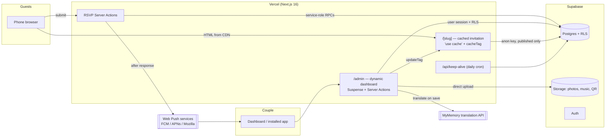
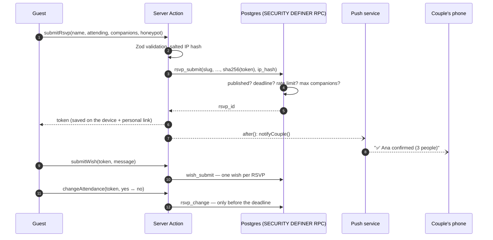

# Architecture

The platform is a single Next.js 16 application backed by Supabase. It serves two very different audiences from the same codebase:

- **Guests** open a public, cached, mobile-first invitation (`/<slug>`). It must load instantly on mobile data and work without an account.
- **The couple** use a private dashboard (`/admin`) that is always rendered per request, behind authentication and Row Level Security.



## Rendering and caching

Next.js 16 runs with **Cache Components** and **Partial Prefetching** enabled.

| Route | Strategy | Why |
| --- | --- | --- |
| `/[slug]` | `getPublicInvitation()` is a `"use cache"` function with `cacheLife("max")` and `cacheTag("invitation:<slug>")`. The page awaits `params` inside `<Suspense>` so the App Shell is served instantly and the full page is stored after the first visit (ISR). | Every guest gets a static page from the CDN. |
| `/admin/*` | Each page renders a static header and streams its data behind `<Suspense>`. `getAdminContext()` calls `connection()` and is memoized per request with React `cache()`. | Session-dependent data can never be prerendered or shared. |
| Server Actions | Every mutation re-checks the session, the wedding membership and the role, then calls `updateTag("invitation:<slug>")`. | The couple sees their change on the public invitation immediately (read-your-own-writes). |

## Bilingual invitation without flicker

Guest-facing text is rendered **in both languages** (`<T es="…" en="…" />` emits two spans). A tiny inline script, placed as the first child of the invitation, picks the language before the first paint — the saved preference, otherwise Spanish for Spanish-language phones and English for everything else — and sets `data-lang` on the container. CSS hides the other language.

This keeps the page fully cacheable (one HTML for everyone), switching language is instant, and the background music never stops.

Content the couple writes in Spanish is translated **once, on save** (`syncTranslations`). Each translation stores the Spanish source it came from, so:

- unchanged texts are never re-translated, and manual corrections are preserved;
- editing the Spanish text automatically invalidates the old translation;
- if the translation service is unavailable, the Spanish text is shown and the dashboard flags it as pending.

## Template engine

Templates are **data, not stylesheets**. Each entry in [`src/lib/templates.ts`](../src/lib/templates.ts) declares a palette, a script and a heading font, an ornament set, a photo frame, a card style, a button shape and a recommended background. The invitation turns that into CSS custom properties (`--inv-*`) and `data-*` attributes on its root, and [`invitation.css`](../src/components/invitation/invitation.css) styles every variant once:

| Attribute | Variants |
| --- | --- |
| `data-card` | `soft`, `outline`, `gold`, `veil` |
| `data-frame` | `polaroid`, `arch`, `oval`, `circle`, `deco`, `plain` |
| `data-button` · `data-names` | `pill` / `square` · plain or gold-foil names |
| `data-bg` | 14 backgrounds (see [`src/lib/backgrounds.ts`](../src/lib/backgrounds.ts)) |
| `data-tone` | `dark` switches form controls, errors and the gift box to light-on-dark |

Backgrounds are independent of templates: they are painted on a fixed layer (`.inv-backdrop`) from the template's own colors, with SVG patterns applied as CSS masks, so any template can be combined with any background. The envelope, wax seal and gift box derive their colors from the palette with `color-mix()`, and the botanical ornaments are original SVGs that read `--inv-orn-*` variables.

Adding a template is one object in the catalog; adding a background is one entry plus one CSS rule. Fonts are loaded with `next/font` and only downloaded when a template uses them.

## RSVP flow



Guests have no accounts. A random 192-bit token identifies their answer; only its SHA-256 hash is stored. The token lives in `localStorage` and in a personal link (`/<slug>?respuesta=<token>`) so the answer can be changed from another device.

## Media pipeline

1. The dashboard compresses photos **in the browser** (canvas → WebP, or JPEG on Safari; max 2000 px) and keeps QR codes as lossless PNG.
2. Files go straight to Supabase Storage under `<wedding_id>/<kind>/<uuid>.<ext>` — never through the server.
3. A Server Action validates the path, type and size and registers the file; a database trigger enforces the limits (30 photos, one cover, one song, one QR).
4. Guests receive images through `next/image`, so Vercel's CDN serves optimized versions and Supabase egress stays low. Music is only downloaded after the guest opens the envelope.

## Notifications

The dashboard is an installable PWA ("Mi boda"). Enabling notifications registers `public/sw.js`, subscribes with VAPID and stores the subscription in `push_subscriptions`. On every RSVP, change or wish the server sends an encrypted Web Push message; expired subscriptions (HTTP 404/410) are removed automatically. On iPhone, Web Push requires adding the dashboard to the home screen (iOS 16.4+).

## Project structure

```
src/
├── app/
│   ├── [slug]/                 Public invitation, RSVP actions, .ics route
│   ├── admin/
│   │   ├── (panel)/            Dashboard pages (overview, guests, wishes, content,
│   │   │                       gallery, music, gifts, appearance, settings)
│   │   ├── login/ recuperar/   Authentication
│   │   └── vista-previa/       Live preview, even before publishing
│   ├── api/keep-alive/         Daily cron endpoint
│   └── auth/confirm/           Email link handler (password recovery)
├── components/
│   ├── invitation/             Guest experience (envelope, gallery, RSVP form, …)
│   └── ui/                     shadcn/ui primitives
├── lib/                        Data access, translations, templates, dates, ICS, push
└── proxy.ts                    Session refresh + optimistic auth redirect
supabase/migrations/            Versioned SQL (schema, RLS, functions, storage)
scripts/                        Migrations, wedding creation, demo seeding
```
