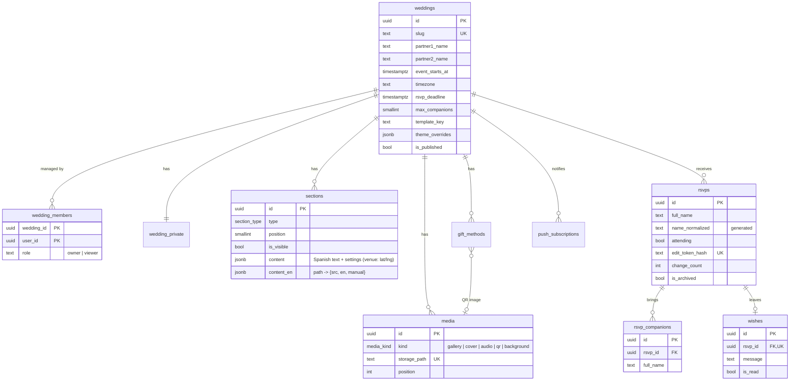

# Database

PostgreSQL on Supabase. Every table hangs from `weddings`, so one deployment can host many weddings. The schema lives in versioned migrations under [`supabase/migrations`](../supabase/migrations) and is applied with `npm run db:migrate`.

## Access control (Row Level Security)

| Table | Anonymous guest | `viewer` (demo) | `owner` (couple) | Server role |
| --- | --- | --- | --- | --- |
| `weddings` | read if published | read own | read + update own | all |
| `sections`, `media`, `gift_methods` | read visible, published | read own | full | all |
| `rsvps`, `rsvp_companions`, `wishes` | — | read own | full | all (via RPC) |
| `wedding_private`, `push_subscriptions` | — | read own / — | full | all |
| Storage `wedding-media` | public read | — | write own folder | all |

Each table has **one permissive policy per role and action** (for example *Members read sections* and *Owners insert / update / delete sections*), so Postgres evaluates a single policy per query.

The policies rely on small `SECURITY DEFINER` helpers that live in the **`private` schema**, which the Data API does not expose — they can be used inside policies but never called as RPCs:

| Helper | Meaning |
| --- | --- |
| `private.is_wedding_member(id)` | The signed-in account belongs to the wedding (any role) — reads |
| `private.is_wedding_editor(id)` | The account is an `owner` of the wedding — writes |
| `private.is_published_wedding(id)` | The wedding is published — public reads |
| `private.can_manage_storage_object(name)` | The file lives in a folder of a wedding the account owns |

`anon` and `authenticated` have `USAGE` on `private` only to evaluate these helpers; no table there is readable (it also holds `schema_migrations`).

**New tables** must enable RLS, add one policy per action using these helpers, and index every foreign key.

## Server-only functions

Guests never write to tables directly. The RSVP Server Actions call these functions with the service role; `anon` and `authenticated` cannot execute them.

| Function | Purpose |
| --- | --- |
| `rsvp_reply` | Saves the answer, its companions and the optional wish in one transaction (one notification per guest). |
| `rsvp_submit` | Building block of `rsvp_reply`: creates the RSVP and its companions. Checks publication, deadline, max companions and a per-connection rate limit. |
| `rsvp_status` | Returns the guest's own answer from their token hash. |
| `rsvp_change` | Switches Yes ↔ No before the deadline; increments `change_count`. |

## Realtime

`rsvps` and `wishes` belong to the `supabase_realtime` publication so the dashboard updates live. `rsvps` uses `REPLICA IDENTITY FULL`, which lets the dashboard see the previous answer in update events (to announce Yes ↔ No changes). Realtime evaluates Row Level Security with each subscriber's token, so a couple only receives their own wedding's changes.

## Indexes

Every foreign key is indexed. `rsvps.name_normalized` and `rsvp_companions.name_normalized` carry trigram (`gin_trgm_ops`) indexes for duplicate detection; Supabase's performance advisor lists them as unused until a wedding has enough guests for the planner to choose them — keep them.

## Advisors

Supabase's security and performance advisors report **no errors and no warnings** apart from *Leaked password protection*, which is only available on the Pro plan (see [Deployment](deployment.md#supabase-settings)). Run them again after every migration: **Advisors → Security / Performance → Rerun linter**.

## Integrity rules

- `name_normalized` (accents, punctuation and case removed) plus `pg_trgm` similarity powers duplicate detection across guests **and** companions (`rsvp_duplicate_matches`).
- Triggers keep companions consistent: none when the answer is "No", never above `max_companions`, and they are removed automatically when someone changes to "No".
- `enforce_media_limits` caps uploads per wedding (30 photos; one cover, song and QR) and checks that files live in the wedding's own folder.
- `wedding_stats` aggregates the dashboard numbers with the caller's permissions (`SECURITY INVOKER`).
