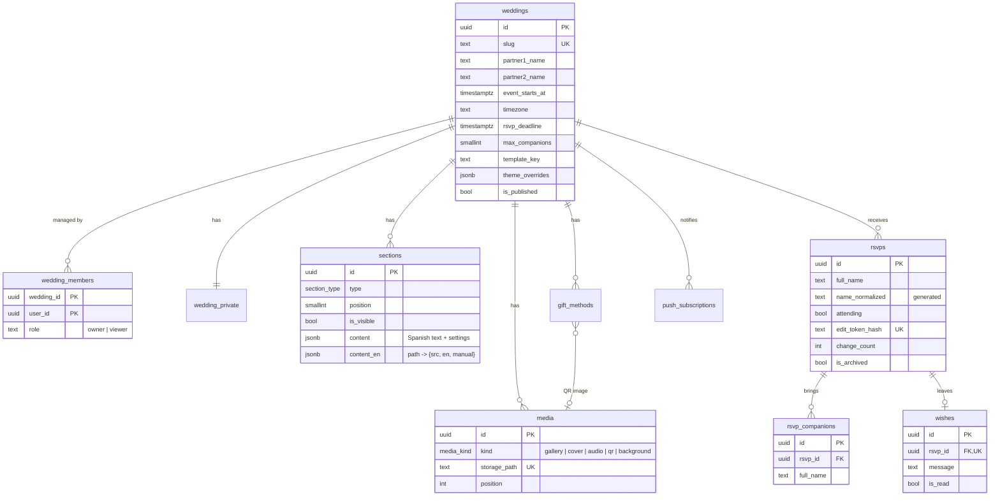

# Database

PostgreSQL on Supabase. Every table hangs from `weddings`, so one deployment can host many weddings. The schema lives in versioned migrations under [`supabase/migrations`](../supabase/migrations) and is applied with `npm run db:migrate`.

## Access control (Row Level Security)

| Table | Anonymous guest | `viewer` (demo) | `owner` (couple) | Server role |
| --- | --- | --- | --- | --- |
| `weddings` | read if published | read own | read + update own | all |
| `sections`, `media`, `gift_methods` | read visible, published | read own | full | all |
| `rsvps`, `rsvp_companions`, `wishes` | — | read own | full | all (via RPC) |
| `wedding_private`, `push_subscriptions` | — | read own / — | full | all |
| Storage `wedding-media` | public read | — | write own folder | all |

Helpers: `is_wedding_member(id)` (any role) for reads and `is_wedding_editor(id)` (`owner`) for writes. Both are `SECURITY DEFINER` and read `auth.uid()` once per query.

## Server-only functions

Guests never write to tables directly. The RSVP Server Actions call these functions with the service role; `anon` and `authenticated` cannot execute them.

| Function | Purpose |
| --- | --- |
| `rsvp_submit` | Creates an RSVP and its companions. Checks publication, deadline, max companions and a per-connection rate limit. |
| `rsvp_status` | Returns the guest's own answer from their token hash. |
| `rsvp_change` | Switches Yes ↔ No before the deadline; increments `change_count`. |
| `wish_submit` | Stores the guest's single private wish. |

## Integrity rules

- `name_normalized` (accents, punctuation and case removed) plus `pg_trgm` similarity powers duplicate detection across guests **and** companions (`rsvp_duplicate_matches`).
- Triggers keep companions consistent: none when the answer is "No", never above `max_companions`, and they are removed automatically when someone changes to "No".
- `enforce_media_limits` caps uploads per wedding (30 photos; one cover, song and QR) and checks that files live in the wedding's own folder.
- `wedding_stats` aggregates the dashboard numbers with the caller's permissions (`SECURITY INVOKER`).
