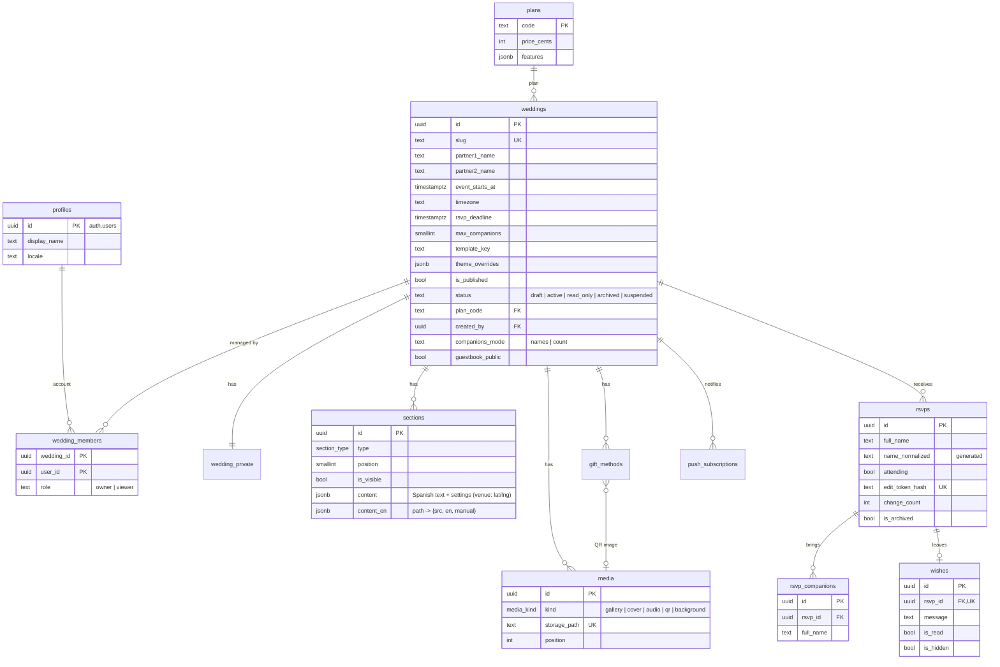

# Database

PostgreSQL on Supabase. Every table hangs from `weddings`, so one deployment hosts every couple of the platform (Lazo de Oro); accounts, plans and platform analytics sit beside them. The schema lives in versioned migrations under [`supabase/migrations`](../supabase/migrations) and is applied with `npm run db:migrate`.

Platform tables outside the diagram: `platform_admins` (back-office access), `platform_push_subscriptions` (admins' devices), `analytics_events` (product funnel, no cookies), `audit_log` (sensitive actions) and `error_log` (server errors). All server-only.

## Wedding lifecycle

`weddings.status` drives what guests see and what the couple can change. Only the platform (server role) moves a wedding between states; the database rejects any attempt from the couple's session.

| Status | When | Guests | Couple |
| --- | --- | --- | --- |
| `draft` | Created from an account, never published | — | edits |
| `active` | Published at least once — publishing a draft activates it automatically and stamps `published_at` | see it while `is_published` | edits, can unpublish |
| `read_only` | 30 days after the event | see it; replies closed | reads and exports only |
| `archived` | 12 months after the event (30-day notice) | — | reads; media is removed |
| `suspended` | Hidden by the platform (abuse) | — | reads |

Other rules enforced by the database:

- **Replies** are only accepted while the wedding is `draft` or `active` (`RSVP_CLOSED` otherwise).
- **Accounts** can own as many live weddings as their plan allows (`features.max_weddings`, 1 on the free plan).
- **Slugs** are 3–60 characters and cannot take a reserved app path (`panel`, `crear`, `admin`, …).
- **Settings per wedding:** `companions_mode` (`names` asks for each companion's name; `count` stores only `rsvps.companions_count`) and `guestbook_public` (private by default; hidden wishes never show).

## Plans

Every wedding points to a plan. Today the only one is `free`, with every feature included; paid plans are new rows in `plans` plus an orders table, without changing weddings.

## Access control (Row Level Security)

| Table | Anonymous guest | `viewer` (demo) | `owner` (couple) | Server role |
| --- | --- | --- | --- | --- |
| `weddings` | read if published and active or read-only | read own | read + update own while open | all |
| `sections`, `media`, `gift_methods` | read visible, published | read own | full | all |
| `rsvps`, `rsvp_companions`, `wishes` | — | read own | full | all (via RPC) |
| `wedding_private`, `push_subscriptions` | — | read own / — | full | all |
| Storage `wedding-media` | public read | — | write own folder while open | all |
| `plans` | read active | read active | read active | all |
| `profiles`, `platform_admins` | — | read own | read own, update own profile | all |
| `analytics_events`, `audit_log` | — | — | — | all (server only) |

Each table has **one permissive policy per role and action** (for example *Members read sections* and *Owners insert / update / delete sections*), so Postgres evaluates a single policy per query.

The policies rely on small `SECURITY DEFINER` helpers that live in the **`private` schema**, which the Data API does not expose — they can be used inside policies but never called as RPCs:

| Helper | Meaning |
| --- | --- |
| `private.is_wedding_member(id)` | The signed-in account belongs to the wedding (any role) — reads |
| `private.is_wedding_editor(id)` | The account is an `owner` of the wedding — notification devices |
| `private.can_edit_wedding(id)` | The account is an `owner` and the wedding is `draft` or `active` — writes |
| `private.is_published_wedding(id)` | The wedding is published and `active` or `read_only` — public reads |
| `private.can_manage_storage_object(name)` | The file lives in the folder of a wedding the account can edit |

`anon` and `authenticated` have `USAGE` on `private` only to evaluate these helpers; no table there is readable (it also holds `schema_migrations`).

**New tables** must enable RLS, grant privileges explicitly (the project exposes nothing by default), add one policy per action using these helpers, and index every foreign key. Tables only the server uses (`analytics_events`, `audit_log`) have RLS on and no client policies on purpose — the security advisor lists them as *RLS enabled, no policy* (info).

## Server-only functions

Guests never write to tables directly. The RSVP Server Actions call these functions with the service role; `anon` and `authenticated` cannot execute them.

| Function | Purpose |
| --- | --- |
| `rsvp_reply` | Saves the answer, its companions and the optional wish in one transaction (one notification per guest). |
| `rsvp_submit` | Building block of `rsvp_reply`: creates the RSVP and its companions. Checks publication, deadline, max companions and a per-connection rate limit. |
| `rsvp_status` | Returns the guest's own answer from their token hash. |
| `rsvp_change` | Switches Yes ↔ No before the deadline; increments `change_count`. |
| `platform_usage` | Database size and bytes/files in Storage, for the back office. |
| `storage_by_wedding` | Bytes and files each wedding keeps in Storage. |
| `public_guestbook` | Wishes the couple has not hidden, of a published wedding whose guestbook is public (author, message), read by the server while rendering the invitation. |
| `set_auth_locale` | Stores the sign-in page language (`es`/`en`) in an account's metadata, so the sign-in email is sent in that language. |

## Realtime

`rsvps` and `wishes` belong to the `supabase_realtime` publication so the dashboard updates live. `rsvps` uses `REPLICA IDENTITY FULL`, which lets the dashboard see the previous answer in update events (to announce Yes ↔ No changes). Realtime evaluates Row Level Security with each subscriber's token, so a couple only receives their own wedding's changes.

## Indexes

Every foreign key is indexed. `rsvps.name_normalized` and `rsvp_companions.name_normalized` carry trigram (`gin_trgm_ops`) indexes for duplicate detection; Supabase's performance advisor lists them — and the indexes of young tables such as `analytics_events` — as *unused* until there is enough data for the planner to choose them. Keep them.

## Advisors

Supabase's security and performance advisors report **no errors and no warnings** apart from *Leaked password protection*, which is only available on the Pro plan (see [Deployment](deployment.md#supabase-settings)). Run them again after every migration: **Advisors → Security / Performance → Rerun linter**.

## Integrity rules

- `name_normalized` (accents, punctuation and case removed) plus `pg_trgm` similarity powers duplicate detection across guests **and** companions (`rsvp_duplicate_matches`).
- Triggers keep companions consistent: none when the answer is "No", never above `max_companions`, and they are removed automatically when someone changes to "No".
- `enforce_media_limits` caps uploads per wedding (30 photos; one cover, song and QR) and checks that files live in the wedding's own folder.
- `gift_methods` has one row per wedding and method (`zelle`, `paypal`, `bank`, `registry`; unique on `wedding_id, type`); method-specific fields live in `details`, a JSON object of at most 4 KB.
- `media.crop` stores how a photo is framed (`{x, y, zoom}`, checked by `media_crop_shape`); null means centered and filling its frame.
- `wedding_stats` aggregates the dashboard numbers with the caller's permissions (`SECURITY INVOKER`).
